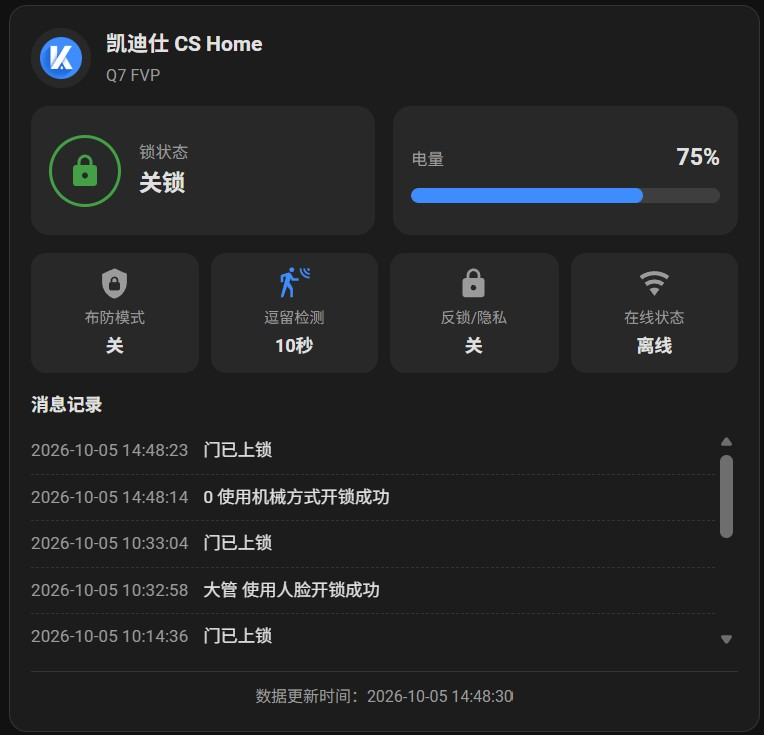

# 凯迪仕智能门锁 (Kaadas) Home Assistant 集成

基于凯迪仕微信小程序云端接口的 Home Assistant 集成。



## 功能

- **锁状态**：开锁 / 关锁（远程开锁暂未实现）

- **状态传感器**：电量、WiFi 信号、固件版本、物模型版本、锁状态、开门方向、自动上锁时间、音量、语言等

- **状态开关**：布防模式、反锁/隐私、双重验证、屏幕、在线状态

- **云端 WebSocket 实时推送 + 轮询兜底**：开关锁 / 上下线 / 门铃靠 WS 即时刷新；轮询作为兜底（可配置自动/手动与间隔）

- **消息记录**：最近操作（操作人 + 操作内容）、最近访客（门铃）、最近预警、近 7 天与当日统计、累计开锁次数

- **事件自动化**：新记录触发 `kaadas_operation` / `kaadas_doorbell` / `kaadas_alarm` 事件

- **抓拍相机**：`camera` 实体显示最近一次门铃 / 预警抓拍图

- **token 自动续期**：openId + 手机号自动重登录换新 token

- **凭证失效自动重新认证**：openId 失效时自动弹出重新认证表单

- **自带 Lovelace 卡片**：`kaadas-lock-card`

## 安装

### 方法一：HACS

1. HACS → 集成 → 右上角「…」→「自定义存储库」

2. 填入仓库地址 `https://github.com/shawjiniu/kaadas-ha`，类别选「集成」

3. 找到「凯迪仕智能门锁」并安装，重启 Home Assistant

### 方法二：手动安装

1. 将 `custom_components/kaadas/` 复制到 Home Assistant 的 `config/custom_components/` 目录

2. 重启 Home Assistant

3. 在「设置 → 设备与服务 → 添加集成」搜索「凯迪仕智能门锁」

## 配置

首次配置需填写小程序凭证（微信开发者工具 / 抓包获取）：

- `openid`：存储键 `openid`

- `phone`：手机号（11 位）

- `openIdToken`：存储键 `login_token`

集成会自动登录换取 token/uid，并自动续期。

## 事件与自动化

集成在检测到**新**记录时，会在 HA 事件总线上触发以下事件（按记录 `id` 去重，首次启动只建基线、不重放历史事件）：

| 事件 | 触发时机 | 事件数据 |
|---|---|---|
| `kaadas_doorbell` | 有人按门铃（访客记录） | `text`、`time`、`thumb_url`、`type`、`event_id`、`wifi_sn` |
| `kaadas_alarm` | 预警（逗留/连续失败锁定等） | 同上 |
| `kaadas_operation` | 开锁 / 上锁 | 额外含 `user_nickname`、`pwd_type`、`pwd_num`、`duress` |

自动化示例：

```yaml
# 门锁预警推送
- alias: 门锁预警通知
  trigger:
    - platform: event
      event_type: kaadas_alarm
  action:
    - service: notify.notify
      data:
        message: "门锁预警：{{ trigger.event.data.text }}"

# 有人按门铃 → 截图 / 执行任务
- alias: 有人按门铃
  trigger:
    - platform: event
      event_type: kaadas_doorbell
  action:
    - service: camera.snapshot
      data:
        filename: /config/www/doorbell.jpg
```

抓拍相机实体搜索「门铃抓拍」「预警抓拍」即可（`camera` 平台）。

## 访客 / 预警记录的获取方式与轮询设置

**门铃/访客与预警都走 WebSocket 推送**：小程序源码确认，云端 WebSocket 会推 `DoorBellRinging`（门铃）、`DoorPanelCall`（面板呼叫）、`Unlock`/`Locked`（开关锁）、`Online`/`Offline`（上下线）与 `iot_property`（物模型属性/事件）。因此：

| 记录类型 | 获取方式 |
|---|---|
| 操作记录（开锁/上锁） | WS 推 `Unlock`/`Locked` → 即时刷新 → 拉 `/record/operation/list` |
| 访客记录（门铃） | **WS 推 `DoorBellRinging`** → 即时刷新 → 拉 `/record/operation/visit` |
| 预警记录（逗留/报警） | **WS 推** → 即时刷新 → 拉 `/record/operation/alarm` |

> 实测：手动模式（不轮询）下仍能收到门铃/访客与预警信息，印证两者都走 WS。

**轮询的作用**：仅作为 WS 断线/漏消息时的兜底补偿；门铃与预警均可完全依赖 WS。

**轮询设置**：设置 → 设备与服务 → 凯迪仕门锁 →「配置」（选项）里可设置：

- **轮询方式**：自动轮询（WebSocket + 定时）或手动轮询（仅 WebSocket + 手动刷新），**默认「手动」（不轮询）**。
- **轮询间隔**：5–3600 秒（默认 30，仅在自动轮询模式下生效）。

**手动刷新**：

- 服务：`kaadas.refresh`（可带可选字段 `entry_id`，留空则刷新全部凯迪仕条目）。
- 卡片：右上角 🔄 按钮，点击立即拉取最新状态与记录。

```yaml
# 手动刷新全部
action:
  - service: kaadas.refresh

# 手动刷新指定条目
action:
  - service: kaadas.refresh
    data:
      entry_id: "abc123..."
```

## 仪表盘卡片

集成自带 `kaadas-lock-card` 卡片，通过集成自己的静态路径 `/kaadas/frontend/` 提供（**不缓存**，无需同步到 `config/www/`）。

- **浏览器**：自动加载，无需任何操作。
- **手机 App**：需**添加一次资源**（只需做一次，之后更新集成无需再动）：

  | 字段 | 值 |
  |---|---|
  | URL | `/kaadas/frontend/kaadas-lock-card.js` |
  | 类型 | JavaScript 模块 |

  在「设置 → 仪表盘 → 资源」点「添加资源」填入上表即可。
  > 不要使用 `/local/kaadas-lock-card.js`——`/local/` 会缓存，容易加载到旧版本。

之后在仪表盘添加卡片时搜索「凯迪仕门锁卡片」，或：

```yaml
type: custom:kaadas-lock-card
entity: lock.kaidas_xxx
```

> 本集成仅开发者个人使用，未经充分测试
